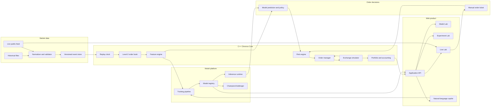

# Chronos — Master Project Plan

## 1. Product vision

Chronos is a real-market research, model-evaluation, and real-time paper-trading platform. It lets a user trade manually through a professional trading interface, choose a prebuilt predictive model, upload a compatible model, or describe a new experiment in natural language. Users can evaluate models on real historical data and then run either their own decisions or approved models against live market data using reproducible methods, realistic execution assumptions, and simulated money only.

The product must connect the full chain:

```text
Real market events
    -> market view and point-in-time features
    -> manual decisions OR model predictions and trading policy
    -> risk checks
    -> simulated orders and fills
    -> positions and PnL
    -> research and live evaluation
```

Manual orders and model-generated orders use the same risk engine, order-management system, exchange simulator, and portfolio accounting. Every order is labeled by its source so users can compare manual trading with model-driven trading without confusing simulated activity with real execution.

The platform is the product. The included models are transparent examples and benchmarks, not claims of guaranteed profitability.

## 2. Portfolio objective

The completed project should demonstrate:

- Modern C++ systems engineering
- Event-driven and latency-aware design
- Real market-data ingestion and order-book reconstruction
- Correct backtesting and execution simulation
- Python model training and quantitative research
- Model serving, registry, and experiment reproducibility
- Live paper evaluation and drift monitoring
- Real-time manual and model-driven paper trading through one shared execution system
- TypeScript web application engineering
- Thoughtful, high-quality product and information design
- A safe natural-language interface over a typed experiment system

## 3. Product principles

1. **Correct before fast.** Optimize only after correctness tests and profiling exist.
2. **Time is explicit.** Exchange time, receive time, prediction time, order-arrival time, and label time are distinct.
3. **No hidden future information.** Features and decisions may use only information available at that simulated instant.
4. **Observed and simulated facts stay separate.** Market events are observed; hypothetical orders and fills are modeled.
5. **Every result is reproducible.** Data, code, configuration, features, model, seed, and assumptions are versioned.
6. **Costs are first-class.** Fees, slippage, latency, partial fills, and turnover appear in primary results.
7. **The UI exposes rigor.** The application explains assumptions instead of hiding them behind a PnL number.
8. **Natural language produces a draft specification.** It never silently deploys arbitrary code or a live strategy.
9. **Real money is out of scope.** The live system is market-data capture and paper evaluation only.
10. **Clarity over cleverness.** Code should be clean, clear, and concise without becoming cryptic; a future contributor should be able to understand the important control flow, invariants, and tradeoffs quickly.
11. **One execution truth.** Manual and model-generated paper orders pass through identical validation, risk, latency, fill, fee, and accounting logic.
12. **Paper trading is unmistakable.** Every trading screen, order, fill, position, report, and exported artifact clearly identifies itself as simulated.

### Code quality requirements

Code quality is a deliverable and part of the definition of done. Every language and subsystem must follow these standards:

- Prefer simple, direct implementations over premature abstractions or clever techniques.
- Keep modules, classes, and functions cohesive and focused on one responsibility.
- Use precise domain names that make financial and temporal meaning explicit.
- Keep public interfaces small, typed, documented, and difficult to misuse.
- Make ownership, mutability, error behavior, units, and time semantics visible in types or interfaces wherever practical.
- Write comments to explain invariants, assumptions, non-obvious decisions, and reasons—not to restate the code.
- Keep functions short enough to understand locally, while avoiding artificial fragmentation into trivial wrappers.
- Remove dead code, stale experiments, unused configuration, and abandoned abstractions before a milestone is considered complete.
- Avoid unnecessary dependencies, inheritance, macros, global state, and indirection.
- Do not trade readability for insignificant performance improvements; any complexity added for performance must be supported by profiling and benchmarks.
- Keep formatting, naming, error handling, and file organization consistent through automated tools and documented conventions.
- Treat compiler warnings, static-analysis findings, lint failures, and formatting failures as build or review failures according to the repository policy.
- Include focused tests alongside behavior so readers can understand the intended contract and important edge cases.
- Require each major component to have a short design note explaining its responsibilities, invariants, boundaries, and known limitations.

Concise code means expressing the required behavior with minimal accidental complexity. It does not mean compressing logic, omitting validation, using obscure language features, or reducing line count at the expense of comprehension.

## 4. Primary users

### Explorer

Selects a supplied model, chooses a real dataset, runs a standardized evaluation, and learns how predictions become trades and PnL.

### Model developer

Trains or uploads a compatible model, registers a version, evaluates it fairly, compares it with a champion, and monitors live paper performance.

### Quant researcher

Defines features, targets, chronological splits, execution assumptions, and promotion rules; analyzes predictive and economic performance.

### Paper trader

Watches a live real-world market, places simulated orders manually, manages open orders and positions, practices risk discipline, and compares personal decisions with prebuilt or uploaded models without risking capital.

## 5. Core user journeys

### Journey A — Evaluate a supplied model

1. Open the Model Library.
2. Select a baseline, champion, or challenger model.
3. Inspect its target, features, training window, and limitations.
4. Choose an approved dataset and market period.
5. Review fees, latency, fill model, and risk limits.
6. Run the historical evaluation.
7. Inspect predictive, trading, and robustness results.
8. Compare the result with other model versions.
9. Optionally promote it to live paper evaluation.

### Journey B — Create an experiment with natural language

1. Describe the prediction question in plain English.
2. Convert the request into a typed experiment specification.
3. Show the inferred target, horizon, features, model family, data split, and success criteria.
4. Display ambiguity, leakage, unsupported-feature, and cost warnings.
5. Require the user to review and approve the specification.
6. Train baseline and challenger models.
7. Evaluate on validation data.
8. Evaluate the selected candidate once on untouched test data.
9. Register the resulting immutable model version.

### Journey C — Upload a model

1. Upload a supported model artifact and manifest.
2. Validate checksum, format, feature schema, output contract, and resource limits.
3. Run compatibility and deterministic-inference tests.
4. Register the artifact as a draft model version.
5. Choose an evaluation specification.
6. Run historical and, later, live paper evaluation.

### Journey D — Monitor a model live

1. Subscribe to a real public market-data feed.
2. Generate timestamped predictions without knowing their outcomes.
3. Save predictions immutably.
4. Score each prediction once its horizon matures.
5. Simulate orders using live observations and configured latency.
6. Monitor predictive quality, PnL, risk, drift, stale data, and system health.
7. Stop the paper deployment automatically when a safety condition is violated.

### Journey E — Trade manually in real time

1. Create or reset a clearly labeled paper account with a configured starting balance.
2. Choose a supported live market and verify that its data is connected, fresh, and sequence-complete.
3. Inspect the live chart, trade tape, spread, order book, and current account exposure.
4. Enter a simulated market or limit order with an explicit side, quantity, price where required, and estimated notional.
5. Review validation, buying-power, position, and risk-limit feedback before submitting.
6. Send the order through the same risk, order-management, latency, fill, fee, and accounting path used by models.
7. Monitor acknowledgements, partial fills, fills, rejections, and the remaining open quantity.
8. Cancel or replace an eligible open order and inspect the complete event history.
9. Manage positions while watching cash, exposure, realized and unrealized PnL, fees, and drawdown update in real time.
10. Compare manual performance with a selected model or let a model take over only after an explicit paper-deployment action.

## 6. System architecture



## 7. Major subsystems

### 7.1 Market-data layer

Required:

- Databento adapter isolated behind Chronos-owned market-event interfaces
- Historical `EQUS.MINI` MBP-1 ingestion for the first top-of-book product slice
- Historical `XNAS.ITCH` MBP-10 and MBO ingestion for later Nasdaq book reconstruction
- Live `EQUS.MINI` recording only after historical replay and execution are correct
- An inexpensive secondary live Level-1 adapter (Alpaca IEX, implemented; IEX-only, not SIP or NBBO) for local paper trading; see `docs/decisions/0009-alpaca-iex-live-adapter.md`
- Snapshot and incremental book updates
- Exchange timestamp and local receive timestamp
- Dataset-aware sequence-gap, duplicate, and out-of-order detection
- Fixed-point price and quantity representation
- Normalized, versioned internal event schema
- Checksums and data-quality reports
- Streaming conversion without loading complete datasets into memory

The accepted provider, dataset scopes, cost policy, licensing boundary, and alternatives are documented in `docs/decisions/0001-market-data-provider.md`.

Later:

- Additional venues and instruments
- Level-3 market-by-order adapter
- Compressed and memory-mapped event storage

### 7.2 C++ replay and order-book core

Required:

- C++20 and CMake
- Deterministic simulated clock
- Stable ordering for equal timestamps
- Level-2 bid and ask reconstruction
- Best bid/ask, spread, midpoint, microprice, and depth queries
- Strategy callbacks and timers
- Explicit reset between runs
- Reproducibility from configuration and seed
- Benchmarks for parsing, book updates, feature calculation, and replay

### 7.3 Feature engine

Initial point-in-time features:

- Spread in ticks and basis points
- Top-level and multi-level imbalance
- Microprice deviation
- Signed trade volume
- Order-flow imbalance
- Short-window realized volatility
- Trade and event arrival rates
- Depth and liquidity measures

Requirements:

- Identical feature definitions in training, replay, and live inference
- Feature availability timestamps
- Warm-up and missing-value policies
- Versioned feature definitions
- Tests proving features cannot read future events

### 7.4 Model training

Initial supplied models:

1. No-skill and persistence baselines
2. Logistic regression baseline
3. Gradient-boosted-tree model
4. Small temporal model as an advanced challenger

Initial prediction problem:

- Instrument: one liquid BTC/USD or BTC/USDT market
- Input: Level-2 book plus public trades
- Target: short-horizon mid-price movement
- Horizons: start with 1 second; later compare 100 ms and 5 seconds
- Splits: chronological train, validation, and untouched test periods

Requirements:

- Training configuration saved with each run
- Fixed seeds where supported
- Walk-forward evaluation
- Class-imbalance handling
- Calibration reporting
- No random shuffling across time
- No test-set tuning

### 7.5 Model registry and upload contract

Each model version stores:

- Immutable model ID and semantic version
- Model artifact and checksum
- Runtime and supported format
- Feature schema and order
- Target definition and prediction horizon
- Training-data version and time range
- Feature-code version
- Training configuration and seed
- Source-code commit
- Validation, test, and live-paper results
- Lifecycle state: draft, candidate, champion, archived

Initial upload support:

- One portable model format, preferably ONNX
- One Python adapter for supported research models
- Manifest validation
- Deterministic-inference smoke test
- Input/output shape and type checks
- CPU, memory, and inference-time limits

Uploaded code must never execute with unrestricted host access.

### 7.6 Strategy, execution, and risk

Orders can originate from either a person using the manual order ticket or a model whose separately configured policy converts predictions into orders. Once an order intent is created, both sources use the same downstream contracts and behavior.

Required:

- Confidence threshold
- Position sizing
- Entry and exit policy
- Market and limit orders
- Manual order entry, order preview, cancel, and cancel/replace
- Explicit order-source attribution: manual, prebuilt model, uploaded model, or system risk action
- Order-entry and cancellation latency
- Partial fills
- Maker/taker fees
- Conservative Level-2 queue approximation
- Order acknowledgements, rejections, fills, and cancellations
- Maximum order size, position, notional, active orders, and loss limits
- Kill switch and stale-data protection
- Cash, positions, realized/unrealized PnL, fees, and drawdown

### 7.7 Evaluation system

Predictive metrics:

- Accuracy, balanced accuracy, precision, and recall
- Log loss and Brier score
- Calibration curve
- Correlation or information coefficient with future returns
- Performance by confidence, volatility, spread, and liquidity regime

Trading metrics:

- Gross and net PnL
- Fees, rebates, slippage, and turnover
- Maximum drawdown and exposure
- Fill and cancellation rates
- Maker/taker ratio
- Inventory duration
- Implementation shortfall
- Adverse selection after configurable horizons

Robustness analysis:

- Multiple days and market regimes
- Fee and latency sensitivity
- Threshold and sizing sensitivity
- Chronological out-of-sample analysis
- Results with idealized versus realistic fills

### 7.8 Live paper system

Required:

- Reconnectable real-time market-data stream
- Sequence and stale-feed monitoring
- Clearly labeled paper accounts with starting cash, available buying power, and reset history
- A real-time manual order ticket supporting side, quantity, market/limit type, limit price, preview, submit, cancel, and cancel/replace
- Prebuilt and user-uploaded models that can be explicitly started, paused, resumed, and stopped in paper mode
- The same registered model and strategy contract in historical replay and live paper operation
- A single shared risk, order-management, execution, fee, and accounting pipeline for manual and model-generated orders
- Source attribution and immutable timestamps for every order intent, risk decision, acknowledgement, modification, cancellation, rejection, and fill
- Realistic simulated acknowledgements and fills derived from observed live market data and documented latency, queue, slippage, liquidity, and fee assumptions
- Immutable, timestamped predictions
- Delayed label generation after the prediction horizon matures
- Online predictive metrics
- Unified live order blotter, fill history, cash, positions, exposure, realized/unrealized PnL, fees, and drawdown
- Paper risk limits and automatic shutdown conditions
- Immediate manual kill switch and per-model kill switch; stopping a model cancels or preserves its open orders according to an explicit policy
- Safe behavior for disconnects, stale data, sequence gaps, rejected orders, service restarts, and duplicate client submissions
- Comparison of historical, replay, and live-paper behavior
- Comparison of manual and model-driven results with identical cost and execution assumptions
- No authenticated trading or real order submission

All trading behavior remains simulation. Live market data may be real, but no Chronos component may route an order to a broker or exchange.

#### Paper-liquidity isolation decision

The initial product uses an independent simulated execution world for each paper account or experiment:

- Every account observes the same real market-data feed but maintains its own hypothetical orders, queue estimates, fills, and consumed shadow liquidity.
- One paper user's activity never changes another user's book, fills, positions, or results.
- Within one account, repeated orders must not reuse liquidity that the account's own earlier simulated orders already consumed before the next applicable market update.
- Aggregate fills across all Chronos accounts must never be presented as quantity that the real market could actually have supported simultaneously.
- Execution reports must identify the fill-model version and show price, quantity, latency, depth, queue, slippage, and fee assumptions.
- The UI must warn when order size, market illiquidity, missing depth, or uncertain queue position makes a simulated result unreliable.
- Evaluation must include multiple execution scenarios, including optimistic, baseline, and conservative assumptions, instead of treating one simulated PnL as ground truth.

A shared Chronos exchange in which users compete with one another is deferred. It would be a separate product mode with different semantics rather than an invisible change to individual paper trading.

### 7.9 Champion–challenger automation

Challengers may vary:

- Hyperparameters
- Feature subsets
- Training-window length
- Recent-observation weighting
- Model family
- Ensembles

Promotion must use predefined gates, such as:

- Better validation loss
- Positive net performance after configured costs
- Acceptable drawdown and turnover
- Stable results across multiple periods
- No major degradation in live paper evaluation

The system must be allowed to conclude that no challenger is better.

### 7.10 Natural-language experiment builder

The natural-language layer creates a typed draft containing:

- Instrument and venue
- Target and prediction horizon
- Feature definitions and windows
- Model family and search limits
- Training, validation, and test periods
- Strategy policy
- Fees, latency, and fill assumptions
- Risk limits
- Evaluation metrics and promotion gates

Validation must detect:

- Ambiguous targets
- Impossible or unavailable features
- Feature/target leakage
- Overlapping or invalid time splits
- Unsupported model runtimes
- Missing execution assumptions
- Excessive search spaces

The user reviews the generated specification before training begins.

## 8. Web application and navigation

The web application is a serious research product, not a decorative dashboard. Its design should feel calm, precise, fast, and technically credible.

### Primary navigation

Keep the main navigation small:

1. **Home** — recent runs, active paper sessions and models, data health, and clear actions to trade manually or evaluate a model
2. **Models** — supplied, uploaded, champion, challenger, and archived model versions
3. **Experiments** — create, run, compare, and inspect reproducible experiments
4. **Live Lab** — real-time manual and model-driven paper trading, current market, orders, positions, risk, drift, and system health
5. **Data** — datasets, capture sessions, schemas, checksums, and quality reports

Secondary settings and documentation belong in a compact account/help area, not the primary navigation.

### Key screens

#### Home

- Two prominent starting actions: open a manual paper-trading session or choose/create a model
- Active paper account, live-session, and model-deployment summary
- Recent experiments
- Market-data health
- No generic vanity metrics

#### Model Library

- Curated prebuilt models with clear roles: baseline, champion, challenger
- Filter by target, horizon, model family, and status
- Version history
- Predictive and trading performance shown separately
- Button to upload or create using natural language

#### Model Detail

- Research question and intended use
- Target, horizon, features, and training period
- Version lineage
- Predictive metrics
- Trading metrics after costs
- Robustness and live-paper results
- Known limitations
- Compare and evaluate actions

#### Experiment Builder

- Two entry points: structured form and natural-language prompt
- Generated specification preview
- Inline warnings and unresolved ambiguities
- Dataset and chronological split preview
- Execution and risk assumptions
- Final confirmation before starting work

#### Experiment Run

- Progress through data validation, feature generation, training, evaluation, and reporting
- Reproducibility metadata
- Logs and failures expressed in understandable language
- No fabricated progress percentages

#### Results

- Predictive quality first
- Trading and execution quality second
- Robustness and assumptions third
- PnL, drawdown, inventory, fills, calibration, and sensitivity charts
- Compare with baseline and champion using identical assumptions

#### Live Lab

- Persistent, unmistakable **Paper Trading** status; the interface must never resemble a live-money brokerage confirmation
- Instrument selector, session status, exchange/receive timestamps, data freshness, sequence health, and reconnect state
- Synchronized price chart, recent-trade tape, best bid/ask, spread, depth, and Level-2 order book
- Manual order ticket with buy/sell, quantity, market/limit type, limit price, estimated notional, available buying power, validation, and final submit action
- Open-order management with status, filled/remaining quantity, cancel, cancel/replace, and event timeline
- Model controls for choosing a prebuilt or uploaded model, reviewing its policy and limits, and explicitly starting, pausing, resuming, or stopping paper operation
- Latest immutable predictions, confidence, target horizon, model version, and resulting model order intents
- Unified order and fill blotter with a prominent source label for manual orders and each model version
- Live cash, positions, average entry price, exposure, realized/unrealized PnL, fees, drawdown, and risk-limit utilization
- Side-by-side manual-versus-model performance using the same time window and assumptions
- Drift and calibration monitoring for active models
- Visible account-level and per-model risk state, warnings, and kill switches
- Inspectable trace from a chart/book moment or prediction through risk decision, order events, fill assumptions, and PnL impact
- Thoughtful empty, loading, market-closed, stale, disconnected, recovering, rejected, and risk-halted states

#### Data Catalog

- Venue, instrument, level, time range, size, checksum, and status
- Quality report and known gaps
- Capture-session controls for public market data

### Visual direction

- Research-terminal precision without imitating Bloomberg
- Strong typography and generous spacing
- Restrained neutral palette with one purposeful accent
- Excellent light and dark themes
- Charts designed for inspection, not decoration
- Dense information only where it helps comparison
- No neon-on-black trading clichés
- No excessive gradients, glass effects, or generic AI-purple styling
- Motion only for state transitions and live updates
- Every color-coded state paired with text or shape

### Interaction requirements

- Keyboard-accessible navigation and controls
- WCAG AA contrast
- Responsive at desktop and tablet widths; mobile may be a simplified read-only view
- Persistent run/model context when navigating
- Shareable deep links to models, experiments, and reports
- Clear empty, loading, partial, stale, error, and disconnected states
- Confirmations for model promotion and stopping a live-paper run
- Confirmation for resetting a paper account or invoking a destructive account-wide action; fast deliberate submission for normal paper orders
- Clear prevention of accidental duplicate submissions, especially during retries or reconnects
- No confirmation for harmless exploratory changes
- Tables support sorting and useful column selection without becoming spreadsheet clones
- Charts support aligned hover, zoomable time ranges where useful, and exact-value inspection

## 9. Suggested implementation stack

### Core

- C++20
- CMake
- GoogleTest or Catch2
- Google Benchmark or an equivalent benchmark harness
- Sanitizers and static analysis

### Research and model layer

- Python
- Polars or pandas for analysis
- NumPy and scikit-learn for baselines
- Gradient-boosting library for the first nonlinear model
- PyTorch only when the temporal model is reached
- ONNX for the first portable uploaded-model contract
- Parquet for analytical outputs

### Product layer

- React and TypeScript
- A small typed application API
- Background job worker for long-running training and evaluation
- PostgreSQL for durable metadata once the integrated web phase begins
- Object storage abstraction for datasets, artifacts, and reports
- Local filesystem implementation for initial development

### Integration

- C++ library plus command-line applications first
- Python bindings or a narrow native extension for research
- Background service invokes versioned evaluation jobs
- Web application never embeds quant logic that belongs in the core

## 10. Repository structure

```text
chronos/
├── CMakeLists.txt
├── README.md
├── PROJECT_PLAN.md
├── core/
│   ├── include/chronos/
│   ├── src/
│   ├── tests/
│   └── benchmarks/
├── apps/
│   ├── capture/
│   ├── normalize/
│   ├── replay/
│   └── backtest/
├── python/
│   ├── chronos/
│   ├── bindings/
│   └── tests/
├── models/
│   ├── baselines/
│   ├── manifests/
│   └── examples/
├── services/
│   ├── paper_trading/
│   └── worker/
├── web/
├── configs/
├── experiments/
├── docs/
│   ├── architecture/
│   ├── decisions/
│   ├── research/
│   └── demo/
├── data/
│   └── README.md
└── infra/
```

Large datasets and model artifacts must not be committed directly to Git.

## 11. Delivery roadmap

### Phase 0 — Product and engineering foundation (Week 1)

Deliver:

- Repository structure and automated build
- Architecture and terminology documents
- Initial event, price, quantity, and timestamp types
- Synthetic fixture format
- Product navigation prototype and design tokens
- Decision records for data source, model target, and first runtime

Exit criteria:

- C++ and Python tests run automatically
- A reviewer can understand the system boundaries
- The first vertical slice is precisely defined

### Phase 1 — Real data and market replay (Weeks 2–4)

Deliver:

- Historical Databento adapter
- Small real `EQUS.MINI` MBP-1 recording and provenance manifest
- Normalized event store
- Data-quality report
- Deterministic replay engine
- Validated top-of-book market view
- Small `XNAS.ITCH` recording and Level-2 order book
- Unit, property, integration, and benchmark tests

Exit criteria:

- A real recorded session replays identically across repeated runs
- Sequence gaps and invalid books are detected
- Performance baseline is published with hardware details

This is the one-month credible systems project.

### Phase 2 — Features, baseline models, and honest evaluation (Weeks 5–7)

Deliver:

- Point-in-time feature engine
- Target and label generation
- Chronological data splits
- No-skill, logistic, and boosted-tree models
- Predictive evaluation report
- Feature parity tests between replay and training

Exit criteria:

- Every prediction can be traced to its feature values and market timestamp
- No test data participates in model selection
- Results reproduce from a saved experiment configuration

### Phase 3 — Orders, execution, risk, and PnL (Weeks 8–10)

Deliver:

- Strategy policy interface
- Shared order-intent contract for manual and model-generated decisions
- Order manager and state machine
- Exchange simulator
- Fees, latency, partial fills, and queue approximation
- Portfolio accounting and risk limits
- Manual order preview, submission, cancel, and cancel/replace API contracts
- Immutable order-source and event audit trail
- Trading evaluation report

Exit criteria:

- Accounting reconciles exactly
- Impossible order-state transitions are rejected
- Equivalent manual and model order intents receive identical downstream treatment
- Results show the difference between predictive quality and net trading performance

### Phase 4 — Model registry and polished web MVP (Weeks 11–14)

Deliver:

- Model/version registry
- Initial upload contract
- Background evaluation jobs
- Home, Models, Experiments, Results, Live Lab, and Data navigation shell
- Model Library and Model Detail
- Structured Experiment Builder
- High-quality results experience
- Polished Live Lab shell with manual order ticket, account summary, model controls, order blotter, positions, and risk panels

Exit criteria:

- A new user can select a supplied model and complete a real-data evaluation without using the command line
- The UI exposes assumptions and reproducibility metadata
- Manual and model-generated activity is visually distinguishable while using a consistent trading workflow
- Keyboard, responsive, loading, empty, and failure states are verified

This is the strong three-to-four-month portfolio version.

### Phase 5 — Live market and paper evaluation (Weeks 15–17)

Deliver:

- Reconnectable live feed
- Immutable live predictions
- Delayed labels
- Real-time manual paper-order entry and open-order management
- Real-time paper execution and portfolio accounting shared by manual and model-generated orders
- Prebuilt and uploaded-model paper deployments with start, pause, resume, stop, and per-model limits
- Unified blotter, source attribution, positions, cash, buying power, realized/unrealized PnL, fees, and drawdown
- Stale-data, risk, and shutdown handling
- Complete polished Live Lab trading workspace and monitoring experience

Exit criteria:

- The same registered model runs in replay and live modes
- Predictions are stored before outcomes are known
- A user can place, inspect, cancel, and replace manual paper orders against real-time market data
- A compatible user-uploaded model can trade the same paper account through the same controlled execution path
- Manual and model orders can be compared under identical execution, cost, and risk assumptions
- Every order and fill is traceable to its source and clearly marked as simulated
- Disconnects and data gaps are visible and handled safely

### Phase 6 — Champion–challenger system (Weeks 18–20)

Deliver:

- Bounded hyperparameter and feature searches
- Model lineage
- Promotion gates
- Side-by-side comparison under identical assumptions
- Drift-triggered retraining proposal

Exit criteria:

- A challenger cannot be promoted using test performance alone
- The system can reject all challengers
- Every promoted version has a complete audit trail

### Phase 7 — Natural-language experiment creation (Weeks 21–22)

Deliver:

- Natural-language prompt experience
- Typed experiment-specification generator
- Ambiguity, leakage, unsupported-feature, and split validation
- Human review step
- Saved prompt, generated draft, edits, and final specification

Exit criteria:

- The same request produces a transparent, reviewable experiment plan
- The interface never silently trains or deploys an ambiguous specification
- Invalid requests fail with actionable explanations

### Phase 8 — Hardening and presentation (Weeks 23–24)

Deliver:

- Profiling-driven optimizations
- Fuzzing, sanitizers, fault injection, and performance regression tests
- Final design polish and accessibility pass
- Complete architecture, research, and limitation documentation
- Reproducible public demo dataset
- Five-minute guided demo and deeper technical walkthrough
- Final case study and benchmark report

Exit criteria:

- A new reviewer can build or launch the project from documented steps
- Every headline claim links to evidence
- The demo still works from a clean environment

This is the six-month flagship version.

## 12. Testing strategy

Testing is part of implementation, not a cleanup phase. Every behavioral change must include or update the tests that demonstrate its intended contract. A milestone is not complete merely because its happy-path demo runs locally.

### C++ correctness

- Unit tests for prices, quantities, events, and state machines
- Property tests for order-book invariants
- Golden replay tests
- Parser fuzzing
- Address, undefined-behavior, and thread sanitizers
- Accounting reconciliation tests
- Determinism tests

### Quantitative correctness

- Feature timestamp tests
- Leakage tests
- Label-boundary tests
- Chronological split tests
- Known-answer metric tests
- Fee, latency, and fill sensitivity tests
- Baseline comparisons

### Product correctness

- API contract tests
- Background-job idempotency
- Artifact checksum tests
- Upload isolation tests
- End-to-end user journeys
- Accessibility and keyboard tests
- Responsive and visual-regression tests
- Disconnected and stale-data states

### Unit-test standards

- Write focused unit tests for every public behavior, invariant, state transition, calculation, and important failure path.
- Give tests behavioral names that state the scenario and expected result.
- Keep tests deterministic, isolated, fast, and independent of execution order.
- Use small fixtures and builders that make the relevant input obvious.
- Test boundary values, invalid inputs, overflow-sensitive values, empty state, and repeated operations.
- When a bug is discovered, first add a regression test that reproduces it, then implement the fix.
- Avoid tests that merely duplicate implementation details or pass without asserting meaningful behavior.
- Do not weaken or delete a failing test simply to make the build pass; determine whether the implementation, test, or specification is wrong.
- Run the relevant unit tests during development and the complete suite before merging a milestone.
- Track slow or flaky tests as defects. Quarantining them indefinitely is not acceptable.

### Test pyramid and ownership

Use the smallest test capable of proving the behavior:

1. **Unit tests** validate individual types, calculations, state machines, and invariants.
2. **Component tests** validate a complete subsystem such as an order book, feature pipeline, model adapter, or risk engine.
3. **Integration tests** validate boundaries such as market data through replay or fills through accounting.
4. **End-to-end tests** validate a small number of critical user journeys through the complete platform.
5. **Performance tests** detect material latency, throughput, and memory regressions.

The developer changing behavior owns the related tests, fixtures, documentation, and monitoring updates.

## 13. Professional engineering workflow and on-the-job practices

Chronos should demonstrate how production engineers work, not only what they can code. These practices apply throughout every phase.

### Define work before implementation

Each meaningful change begins with:

- A clear problem statement
- Scope and explicit non-goals
- Acceptance criteria
- Important edge cases and failure modes
- Dependencies and affected components
- A verification plan

Large changes should be decomposed into reviewable increments that preserve a working main branch.

### Local development discipline

Before considering a change complete:

- Build all affected targets from a clean state.
- Run focused tests while iterating.
- Run the complete relevant test suite.
- Run formatting, linting, static analysis, and compiler-warning checks.
- Use sanitizers for memory, undefined-behavior, and concurrency-sensitive changes.
- Inspect logs and outputs for warnings rather than checking only the exit code.
- Benchmark performance-sensitive changes against an established baseline.
- Verify documentation and example commands still work.

### Source-control discipline

- Keep commits small, coherent, and independently understandable.
- Write commit messages that explain the purpose of a change.
- Avoid mixing unrelated formatting, refactoring, and behavior changes.
- Never commit secrets, credentials, generated datasets, large model artifacts, or local machine configuration.
- Preserve a clean, passing main branch.
- Use versioned releases for stable milestones and the submission-ready build.

### Self-review and code review

Every change receives a deliberate self-review before it is considered ready. Review for:

- Correctness and edge cases
- Data leakage and time semantics
- Numerical and accounting correctness
- Thread safety and ownership
- Error propagation and failure recovery
- Security and unsafe artifact execution
- Readability and unnecessary complexity
- Test quality and missing cases
- Performance regressions
- Compatibility with existing configurations and persisted data
- Documentation and observability

Review comments should explain impact and reasoning. Important review findings should become tests, design notes, or checklist improvements so the same class of mistake is less likely to recur.

### Continuous integration

Every proposed change should automatically run the applicable checks:

- C++ debug and release builds
- Unit, component, and integration tests
- Python and web tests
- Formatting and linting
- Static analysis
- Sanitizer jobs where feasible
- Schema and API compatibility checks
- Representative end-to-end test
- Performance-regression checks for protected hot paths

A failing required check blocks integration. Failures must be understood and fixed rather than repeatedly retried until they happen to pass.

### Debugging and diagnosis

When behavior is incorrect:

1. Reproduce it with the smallest reliable input.
2. Preserve the failing input, configuration, logs, and software version.
3. Determine the first point at which actual behavior diverges from expected behavior.
4. Add instrumentation only where it tests a hypothesis.
5. Add a regression test.
6. Implement the smallest correct fix.
7. Check for the same failure pattern in related components.
8. Document the root cause when it teaches a reusable lesson.

The project should use debuggers, sanitizers, profilers, structured logs, replay traces, and invariant checks appropriately instead of relying on print statements alone.

### Observability

Production-style components must expose enough information to answer:

- Is the component healthy?
- Is data fresh and complete?
- How much work is it processing?
- How long does work take?
- What was rejected, dropped, retried, or delayed?
- Which model, configuration, dataset, and version produced this result?
- Can a failure be reconstructed from retained evidence?

Logs should be structured, appropriately leveled, and useful without exposing secrets. Metrics and traces should be added where they support real operational questions.

### Documentation as part of the change

When behavior, configuration, architecture, schemas, or user workflows change, update the corresponding documentation in the same change. Documentation should include:

- Public contracts and examples
- Important invariants and assumptions
- Configuration fields and units
- Failure and recovery behavior
- Operational procedures
- Known limitations
- Relevant architectural decision records

### Compatibility and migrations

- Version persisted event, feature, experiment, and model schemas.
- Detect incompatible versions explicitly rather than silently misreading data.
- Make migrations testable and reversible where practical.
- Preserve backward compatibility when its cost is reasonable; otherwise document and validate the breaking change.
- Test upgrades using representative older artifacts before a release.

### Release and incident practice

Every milestone release should include:

- Version identifier
- Reproducible build information
- Changelog
- Passed verification checklist
- Known limitations
- Benchmark summary when performance changed
- Rollback or recovery instructions where applicable

For meaningful failures, write a concise blameless incident review containing the impact, timeline, root cause, contributing conditions, detection gap, corrective actions, and tests or controls added afterward.

### Professional definition of done

A work item is done only when:

- Acceptance criteria are satisfied.
- Implementation is clean and reviewed.
- Relevant unit and higher-level tests pass.
- The failure paths have been exercised.
- Static checks and required CI jobs pass.
- Performance has not regressed unexpectedly.
- Logs, metrics, and errors are adequate for diagnosis.
- Documentation and examples are current.
- The result is reproducible from committed configuration.
- No temporary workaround, disabled test, or unexplained warning remains.

## 14. Performance requirements

Measure rather than speculate. Publish:

- Parsing throughput
- Order-book updates per second
- Feature calculations per second
- End-to-end replay throughput
- Model inference latency distribution
- API and job-queue timings
- Peak memory usage

Initial target: process at least one million simple Level-2 updates per second on a modern development machine, or publish a precise profile explaining the limiting component. Any stronger claim must be supported by a reproducible benchmark.

## 15. Security and safety boundaries

- No real-money order submission
- No broker or exchange trading credentials
- No hidden or dormant route from the paper order API to a broker, exchange, or real-money account
- Every trading surface and exported result displays its simulated status
- Manual and model orders are subject to server-side validation, position limits, notional limits, loss limits, rate limits, and kill switches
- Model deployments require an explicit paper-only start action and can be stopped independently
- Duplicate submission protection and idempotent client order identifiers are required
- Uploaded artifacts have strict format and resource limits
- No unrestricted execution of uploaded Python
- Natural language cannot bypass typed validation
- Secrets never appear in experiment artifacts or logs
- Dataset and model artifacts are checksummed
- Destructive lifecycle actions require explicit confirmation

## 16. Explicit non-goals

- Guaranteed profitable trading
- Autonomous real-money deployment
- Acting as a brokerage, exchange, investment adviser, or source of real-money trade execution
- Copy trading, social trading, deposits, withdrawals, custody, or funding accounts
- A shared multi-user simulated exchange in the initial paper-trading product
- Perfect fill reconstruction from Level-2 data
- Supporting every model framework
- Supporting every asset class or exchange
- Building a generic enterprise MLOps platform
- Using deep learning before baselines exist
- Using an LLM to generate arbitrary production trading code
- Adding low-latency techniques that benchmarks do not justify
- Prioritizing mobile authoring over the desktop research experience

## 17. Five-minute final demo

1. Open Home and show healthy real market data.
2. Open Live Lab and verify the prominent paper-only state, real-time chart, trade tape, and Level-2 book.
3. Place a manual limit order, watch it pass risk checks, and inspect its acknowledgement, partial/full fill, position, fees, and PnL.
4. Cancel or replace another manual order and inspect its immutable event timeline.
5. Enter the Model Library and select the supplied boosted-tree champion.
6. Show its target, features, lineage, test result, live-paper result, policy, and risk limits.
7. Start the model in paper mode and show its predictions and orders beside manual activity, each with clear source attribution.
8. Upload a compatible user model or show a previously validated upload, then demonstrate that it uses the same paper execution path.
9. Run a historical evaluation on a held-out real market session and show how fees, latency, and partial fills change performance.
10. Describe a challenger in natural language and review the generated typed specification and a leakage warning.
11. Compare the challenger, champion, and manual session under identical assumptions and show that promotion follows predefined gates.
12. Trigger a safe paper-risk limit or stale-data condition and show that order entry/model operation halts visibly without any real order being sent.

## 18. Definition of project success

Chronos succeeds when a technical reviewer can verify that:

- It processes real market data.
- Its order book and replay system are correct and deterministic.
- Its features contain no future information.
- Its models are evaluated on untouched chronological data.
- Its execution results include realistic costs and clearly stated assumptions.
- Its live predictions are recorded before their outcomes.
- A user can manually paper trade against real-time market data through a polished, responsive, and understandable interface.
- Users can run supported prebuilt and uploaded models in real-time paper mode with explicit lifecycle and risk controls.
- Manual and model-generated orders use the same risk, order-management, execution, fee, and accounting implementation.
- Every simulated order and fill is source-attributed, auditable, and impossible to mistake for real-money activity.
- Its model versions and experiments are reproducible.
- Its natural-language layer produces reviewable specifications rather than opaque magic.
- Its interface is polished enough to make complex research understandable.
- Its performance and correctness claims are backed by tests and measurements.
- Its implementation is clean, clear, concise, consistently organized, and understandable without relying on hidden context or unnecessary cleverness.
- Its development history demonstrates professional testing, review, debugging, CI, documentation, observability, and release practices used in real engineering teams.

## 19. Immediate next milestone

Build a real-data-to-paper-account vertical slice in small, verified increments:

1. **Complete:** Record the market-data provider, dataset, licensing, and cost decisions.
2. **Complete:** Separate the fixed-point scales and contracts for price, quantity, and money.
3. **Complete:** Define provider-independent instrument, trade, quote, quality, and timestamp types.
4. **Complete:** Add a historical Databento adapter and immutable recording manifest.
5. **Complete:** Normalize and inspect a short real `EQUS.MINI` MBP-1 session for `AAPL` and `SPY`.
6. **Complete:** Replay the recording deterministically and maintain a validated current market view.
7. **Complete:** Add a shared manual/model order-intent contract, risk checks, and simple top-of-book execution.
8. **Complete:** Feed simulated fills into the existing accounting core and verify end-to-end reconciliation.
9. **Complete:** Persist account, order, rejection, fill, and portfolio events atomically and recover after restart.
10. **In progress:** Expose the path through a typed API and then a minimal real web order ticket, blotter, and portfolio view. The first API slice is complete: health, paper-account creation and retrieval, and immediate-or-cancel order submission against server-owned market state. The durable read side is complete: newest-first order and fill history with keyset pagination, and order lookup for reconciling uncertain submissions. Read-only portfolio valuation is complete: the durable account is marked at the server's current best bid with exact, reconciled market value, unrealized and total PnL, equity, and return, and refuses to value against missing, interrupted, suspect, or incompatible market data. The first web workspace is complete as a local React and TypeScript client: account creation and selection, market and portfolio views, a manual market/limit IOC order ticket with reconciliation of uncertain submissions, and durable order and fill history. Paced replay is complete: the server plays a recording by receive time at `1x`, `10x`, `100x`, or `max` while it serves requests, behind a provider-independent market-data source boundary with start, pause, and resume controls, and the workspace refreshes market-dependent views on coalesced Server-Sent Events change notices, falling back to polling. The first live source is complete: an optional Alpaca IEX adapter streams live Level-1 trades and quotes over one WebSocket, with an explicit connect, authenticate, and subscribe lifecycle, bounded reconnection, exact fail-closed normalization, environment-only credentials, and live freshness rules that never serve a quote while the feed is down or before a fresh quote arrives. It is labelled as IEX-only, not SIP or NBBO, and consumes market data only. Multi-instrument paper accounts are complete: an account holds one shared USD cash balance and a durable ledger per instrument, every order names one tradeable instrument and executes only against that instrument's quote and displayed liquidity, client order IDs are unique across the account, the position limit applies per instrument, portfolio valuation marks every held position all or nothing and names each one it cannot mark, PostgreSQL stores normalized position and execution-state rows with commit-time integrity checks after a transactional, loss-free migration of single-instrument data, history can be filtered by instrument, and the workspace has a watchlist, a ticket symbol selector, and position tables. Durable good-til-cancelled working orders are complete: a limit order may be GTC, executes at once as far as displayed liquidity allows, and works across restarts until later top-of-book observations of its own instrument fill it in FIFO priority, one transaction per account, synchronously with the market stream and without dropping an event; it pays one fee, on its first fill; its remaining cash or shares are reserved server-side and enforced by risk and commit-time database checks; a client can cancel its remainder idempotently by cancel request ID, without market data; PostgreSQL stores each order's current state and every fill after a transactional, validated, loss-free migration; the API lists working orders and each order's fills and lifecycle events; and the workspace has a time-in-force selector, a working-orders panel with reservations and reconciled cancellation, and an order lifecycle view refreshed by account-activity notices. Replace (amending a working order) and authentication remain.
11. Add a small `XNAS.ITCH` recording and Level-2/Level-3 book work before introducing queue and partial-fill assumptions.
12. **In progress:** Build the historical evaluation foundation. The first slice is complete: a provider-independent, immutable, content-addressed normalized market dataset (canonical NDJSON of every Chronos event with raw fixed-point strings, a strict manifest, and a deterministic quality report), published atomically, verified end to end by a `MarketEventReader` that replay uses unchanged, converted offline from Databento recordings; and a point-in-time `top_of_book` version 1 feature engine with exact, typed-unavailability features and reproducible feature artifacts. The second slice is complete: immutable `future_midpoint_return` version 1 label artifacts (the exact fixed-point midpoint return to the first observation of the same instrument at least one horizon later, never skipping an unavailable one, typed reasons for every unavailable label, and a label availability time separate from the prediction time); immutable `chronological_purged` version 1 split artifacts (contiguous train, validation, and test periods that never divide equal prediction times, with labels that cross a boundary purged and the no-leakage inequalities checked on writing and reading); and a Python research package that consumes those artifacts only after the C++ verifier has reproduced them, trains a no-skill majority baseline and a multinomial logistic-regression baseline per instrument on training rows only, and publishes an immutable, content-addressed evaluation artifact with plain-number model parameters, stored-parameter inference proven against scikit-learn, and exact, typed metrics. The third slice is complete: a saved, reproducible research demonstration (`python -m chronos_research demo`) takes the local recording, or synthetic events in CI, through every artifact and verifies the whole ancestry, reusing every artifact on a repeat run ([docs/research-walkthrough.md](docs/research-walkthrough.md)); a label-free, immutable inference schedule infers a fitted model on every feature row of one instrument in a validation or test window, including the unlabelled tail, without ever reading label or split rows; a deterministic C++ strategy runner (`chronos_strategy`) evaluates one versioned long/flat policy over the verified dataset through the existing `PaperOrderProcessor`, risk, fill, fee, liquidity, accounting, and valuation code, with delayed IOC orders that never fill on their own quote, beside cash and buy-and-hold benchmarks, into an immutable result with a full decision, order, execution, and valuation journal, exact PnL, fees, turnover, and drawdown, and explicit unavailable valuations ([docs/strategy-evaluation.md](docs/strategy-evaluation.md), ADR 0016); and a separate loopback research service with bounded, durable, deduplicated jobs and a Research view in the web workspace start evaluations and show their trades, equity, drawdown, costs, benchmarks, and provenance ([docs/research-service.md](docs/research-service.md), ADR 0017). On the demonstration data the policy lost money in every window, and more than buying and holding. Boosted trees, calibration reporting, and richer policies and cost models are next (the model registry is item 14 and walk-forward evaluation item 15); no result is evidence of skill or profitability yet.
13. **In progress:** Controlled model-driven paper deployment. The first slice is complete ([docs/model-deployments.md](docs/model-deployments.md), ADR 0018).
    - **Running.** A verified `logistic` or `majority` research model runs in the paper-trading server, with an explicit `--model-deployments` opt-in. It is served by a long-lived Python inference worker whose predictions are bit-identical to the historical schedules'. It trades one instrument, long or flat and at most one share, under the shared `long_flat_threshold` version 1 policy, in a dedicated paper account it owns from creation.
    - **Handoff and timing.** A bounded handoff runs from the feed (the matcher first, then point-in-time features, then a one-slot mailbox per deployment with counted supersession) to a runner thread. The runner never decides before the training cutoff or on an observation at or before its durable watermark.
    - **Durable decisions.** Every decision is recorded before anything acts on it. A trusted order path re-checks everything at acceptance under the gate and the account, deployment, and decision locks, and executes a market IOC order on a later quote at least the latency after the signal. The order and its decision's resolution commit atomically.
    - **Ownership.** Ownership is enforced server-side and by a database trigger; manual orders on an owned account return `409`.
    - **Controls.** Start, Stop, and the kill switch are idempotent and never liquidate. A restart never resumes.
    - **API and UI.** API routes and a Research UI cover create, review, start, stop, the kill switch, status, and decisions.
    - **Tests.** They cover PostgreSQL migration and recovery; failpoints for uncertain commits, lost connections, failed commits, Stop during a submission, inference failures, staleness, halts, restarts with old observations, duplicate controls, and shutdown; Alpaca fake-transport reconnection; and browser accessibility.
    - **Paced-replay proof.** A paced 10x replay traded real paper orders. An independent check against the recording confirmed every input, fill, and the PnL to the cent.

    - **Visibility.** The deployment card now says what a deployment is doing,
      separately from what it last decided ([ADR 0019](docs/decisions/0019-deployment-observability.md)).
      The server derives one condition by precedence: lifecycle, source,
      quote, pending order, then latest candidate. It uses a bounded,
      process-local runner snapshot and read-time market state, with no
      database work on the trading path. Decisions report booked fills and
      exact market-clock durations, which are unavailable with a reason
      rather than zero. The UI keeps market, server wall, and work clocks
      apart.
    - **Live validation.** Fake-transport tests cover connecting, a reconnect
      while pending, silence, a crossed book, the kill switch, and restart.
      An opt-in validation tool runs a read-only database preflight (it
      catches a version-5 database missing the deferred guard), a bounded
      live session, and an independent audit. On 2026-10-04 (a Sunday) the
      real IEX check reached the handshake only. On 2026-10-05, a separate
      market-hours run proved 23 live decisions, five paper orders and
      fills, and independently reconciled accounting. A separate no-trade
      deployment proved explicit Stop and crash recovery without automatic
      resume. Browser controls and live outcomes passed at desktop/mobile
      widths. This does not establish model skill; this run had zero fees.
      Live triggering inputs were not independently re-derived, and a real
      disconnect or pending-live-order crash was not exercised.
    - **Durable live-stream continuity (ADR 0020), code-reviewed and
      fresh-account live-verified; awaiting milestone acceptance.** Process restart reset the Alpaca
      ingest counter while keeping the stream ID: a fresh quote with
      sequence 70 was refused by an account whose execution quote had
      sequence 1087 (`incompatible_market_timeline`).
      - **Mechanism.** A live stream's sequences now come from blocks
        reserved in `live_stream_sequences` (migration 006), under an
        exclusive writer lease that expires in the database's clock. A new
        run's jump is declared only while the market state is suspended.
      - **Revised after Codex's review (2026-10-06).** The first version's
        "one publisher at a time" rested on a local check before apply,
        which is not a fence. Now:
        - order, fill, and decision commits are fenced against the stream's
          current writer generation (migration 007), under a share lock
          that a takeover waits for; valuation checks the current generation
          before using its quote;
        - frames are bound to their publication run, which a loss, lapse,
          or reacquisition ends;
        - quotes stop being executable at a lapse without traffic, and a
          late renewal does not revive them;
        - `verify-continuity` judges one snapshot, fails on the first
          violation, and uses the server's `first_ingest_sequence` as
          proof, or says it sampled.
      - **Unchanged.** Lineage, freshness, watermark, risk, and accounting
        guards are not weakened, and replay identities do not change.
        Legacy history continues only after an explicit
        `--adopt-live-stream-history`.
      - **Proven with the fake transport and real PostgreSQL:**
        - clean and crash restarts with one fresh quote;
        - manual, GTC, and restarted-deployment orders;
        - pending-decision crash recovery;
        - two instruments, and stream isolation;
        - reconnects, staleness, and forged older or altered quotes;
        - ownership conflict, outage, and exhaustion at 2^64 − 1;
        - legacy adoption.
      - **Real IEX verification (2026-10-07):** a fresh one-share paper
        position was valued and sold after both clean and crash restarts.
        The server's first accepted sequence followed the durable baseline,
        and `verify-continuity` judged the observed fresh quote. Four fills
        independently reconciled to cash/equity 9999.82 and PnL −0.18,
        with zero fees. Duplicate submission did not change history; a
        majority-model control inferred Hold and stayed stopped after crash
        recovery. The development-data fingerprint was unchanged. Test
        storage is now persistent, with a successfully restored backup.
      - **Evidence boundaries:** the earlier tmpfs evidence databases were
        lost in Docker recovery, so this does not rerun the exact legacy
        adoption account. A real network disconnect and pending-live-order
        crash remain unexercised on real data. No broker order was sent.

    Measured limitation: under a fast replay, orders wait for the market-event gate, so the realized signal-to-execution delay (median 0.4–1.1 s of market time at 10x) far exceeds the configured latency, and a few signals expire. Durable live-stream continuity is code-reviewed and fresh-account live-verified, pending milestone acceptance; a fairer gate or matching outside it follows. Several things remain: multi-share and multi-instrument deployments, limit orders, durable run counters, broader real-live reconnect/pending-order acceptance, and authentication.
14. **Complete, reviewed and merged in PR #26** (`1e3b1a1`): a versioned
    model library, constrained model imports, fair historical comparisons,
    and paper deployment of registered versions
    ([ADR 0021](docs/decisions/0021-model-registry-imports-and-comparisons.md)).
    - **A. Model library.** Immutable, content-addressed model versions
      (`chronos.model_version/1`). The record separates the version ID, the
      payload checksum, and the source experiment, with immutable name and
      version bindings and an active or archived lifecycle. Every read is
      verified. Experiment models register as jobs after their sources are
      verified again. The Models page lists, registers, inspects, and
      archives them.
    - **B. Constrained imports.** One ONNX profile
      (`chronos.onnx_classifier/1`: the `top_of_book_baseline/1` inputs,
      three float64 probabilities, eight static operators, bounded size).
      It is checked and run only in a restricted, pinned Docker sandbox:
      no network, read-only, unprivileged, bounded memory, CPU, processes,
      and time, and unavailable rather than weaker without Docker. No
      container outlives its owner: a supervisor token lets the research
      service and the paper server remove and verify a killed child's
      containers, and a per-session watchdog covers an owner that dies with
      no supervisor left. The
      upload is bounded and two-step, and the exact reviewed bytes are
      frozen. A smoke corpus is judged on the host. Declared provenance is
      kept apart from verified provenance, and a missing cutoff is
      unavailable, never zero. `export-onnx` writes a logistic version as
      an import, with a parity report.
    - **C. Comparisons.** 2 to 6 versions under one frozen spec, each
      predicted point in time (schedule version 2), run by the C++ engine
      in its own accounts (strategy run version 2, which names the version
      and never an experiment), rebuilt, and replayed. Refused and failed
      members are kept, benchmarks are checked identical, and deltas are
      exact. Only after every member is predicted are the window's realized
      labels read. Each member's stored predictions are then scored with the
      experiment's metric definitions, shown apart from trading results with
      unscored rows counted by reason. The Comparisons page reviews, starts,
      and shows both side by side.
    - **D. Registered-model deployments.** Migration 008 adds an explicit
      experiment-or-registered variant without loosening migration 005's
      rules for experiment deployments. Worker protocol 2 and
      `--onnx-docker` serve a version by its ID, an import only in the
      sandbox. A deployment is created stopped and re-verified at every
      Start. Archived versions cannot be newly deployed.
    - **Proven on real services:** the AAPL recording's logistic version
      exported and imported through the browser, its parity within 1e-12
      (largest difference 3.3e-16) with every class and policy signal equal
      over 27,724 rows; compared with the majority model and refused models; and
      deployed, started, filled 14 times, stopped, and restarted cleanly and
      after a crash, on an isolated review database.
    - **Limits.** Imports need Docker. An import's cutoff is its uploader's
      declaration and cannot be verified. Only one profile, one instrument,
      and one target exist. No retraining, champion promotion, or
      authentication.
15. **Complete (PR #27):** walk-forward
    evaluation over independent recordings, with fee and latency robustness
    scenarios, from branch `feature/walk-forward-robustness`
    ([ADR 0022](docs/decisions/0022-walk-forward-evaluation.md),
    [docs/walk-forward-evaluation.md](docs/walk-forward-evaluation.md)).
    - **A. Collections and plans.** A verified collection
      (`chronos.research_collection/1`) references existing recordings by
      their label, feature, and dataset artifacts, each re-verified by the
      C++ tools, with coverage, provenance, and declared session labels
      recorded and never upgraded; duplicates, aliases, overlaps,
      inconsistent contracts, and synthetic/observed mixtures are refused.
      An immutable plan (`chronos.walk_forward_plan/1`) fixes expanding
      folds, whole-recording windows, an exclusive information boundary
      (training prediction AND label-availability times strictly before
      it), eligible rows and class support, the strategy configuration, one
      to four fee × latency scenarios, the scoring rule, and a bounded
      workload before any result. Too few recordings is refused with what
      is needed.
    - **B. Fold-local models and execution.** Each fold fits a fresh
      majority and a fresh logistic model (its own scaler) on its training
      rows only, published as historical-only fold models outside registry
      version 1. Schedule version 3 predicts every evaluation feature row
      from features and frozen parameters alone; strategy-run version 3
      names the fold provenance; the C++ engine recomputes every row.
      Versions 1 and 2 are unchanged.
    - **C. Studies.** `chronos.walk_forward_study/1` runs every fold, model,
      and scenario through `chronos_strategy` in its own accounts, replays
      each run, scores only after predictions exist, keeps every outcome
      (completed, unevaluable, failed, not run), pools classification over
      rows, and sums money exactly over reset accounts (return = total PnL /
      total capital, rounded once); a missing valuation or cell leaves only
      a labelled partial aggregate. Inspection rebuilds and replays
      everything.
    - **D. Service and web.** Preview and Start are deduplicated research
      jobs with bounded fold progress; sources are re-verified at
      execution. A Walk-forward workflow inside Research previews a frozen
      plan, starts it, and shows trading per fold first, exact totals, and
      prediction quality separately, with synthetic and partial results
      labelled and fold runs' journals one click away.
    - **Revision after Codex review.** Inspection and the auditor hold every
      run to its cell: the plan's schedule, source, window, and all eight
      frozen options under the cell's scenario; a completed cell needs a run,
      and a cell without one is kept only as exactly a run that failed to
      start. The study page shows each run's verification, and labels
      unverified every row and total that rests on one that does not verify
      or was not checked. The CLI and HTTP share one check of every option
      against the engine's exact limits.
    - **Proven on synthetic recordings only:** three generated days (plus a
      thin day for an unevaluable fold) through the CLI, the service, and
      the browser, at desktop and phone widths with accessibility checks;
      an independent standard-library audit (`tools/walk_forward_audit`)
      recomputed fold membership, cutoffs, training support, confusion
      counts, every fill, fee, cash, position, PnL, and every aggregate
      exactly, with zero differences, and caught planted errors.
    - **Real data:** the only real recording is ten minutes of one session.
      Its collection verifies and its plan is correctly refused for
      insufficient coverage, so **no real multi-session result exists**;
      that evidence is unverified, not passed. More recordings need a
      separate, quote-first, cost-capped acquisition step.
    - **Limits.** One instrument per study, the existing features, horizon,
      two baselines, and long/flat policy; whole-recording windows;
      same-environment reproducibility; no significance claims, promotion,
      or deployment of fold models.
16. **Implemented, reviewed, and accepted (real multi-session results
    pending):** a safe,
    repeatable path to walk-forward studies over several real recordings, on
    branch `feature/real-market-walk-forward-validation`
    ([ADR 0023](docs/decisions/0023-authorized-real-recording-acquisition.md),
    [docs/real-market-validation.md](docs/real-market-validation.md)).
    - **Plans and authorization.** A `chronos.recording_request_plan/1`
      binds the provider query, symbols, each recording's `ts_recv` window,
      stream, session label, and destination or existing file, and freezes
      the evaluation settings before any data. Metadata quotes are read as
      exact decimals; a human authorization binds the plan ID, state root,
      and whole-cent allowance and caps. No default budget exists.
    - **Acquisition.** The only spending command reserves each attempt's
      full cap in an fsynced ledger before the provider child starts, holds
      a root lock the child inherits, never retries or refunds an attempt
      that did not end in a verified recording, and reuses recordings only
      after verifying bytes, manifest, replay, and receipt. The state root is
      a trusted, private directory: links, foreign directories, and ledgers
      that disagree with their authorization and plan are refused before
      anything is reserved.
    - **Preparation and studies.** An offline command verifies, normalizes,
      collects, and runs each instrument's frozen walk-forward study and the
      independent auditor, reporting pending recordings and refusals with
      their reasons.
    - **Fixes.** Dataset provenance now names Databento's `ts_recv` window;
      the generic acquisition seam refuses a non-finite or negative estimate
      before downloading.
    - **Real data:** no new recording was acquired; no paid request was
      made. The pilot plan of five ten-minute AAPL/SPY windows (four new,
      one existing) awaits free quotes and a human budget decision; until
      then the one real recording is verified and correctly refused for a
      multi-session study.

The repository currently implements type-specific fixed-point price, money,
and quantity values; provider-independent market-event types; structured
single-event validation; generic stream identity and ingest-sequence
validation; an optional, pinned Databento `EQUS.MINI` MBP-1 normalizer and
streaming DBN file reader; checksum-backed write-once recording manifests; a
quote-first, cost-bounded historical acquisition command; offline
deterministic replay reports and a current market view; fill types; and an
in-memory multi-instrument long-only paper account with core tests. It now
also implements a shared manual/model order-intent contract, structured
pre-trade risk decisions, and deterministic top-of-book execution of
immediate-or-cancel and good-til-cancelled orders with partial fills and
shadow displayed liquidity. A controlled
paper-order processor now immediately applies simulated fills to its owned
account and returns reconciled execution and accounting receipts. An optional
PostgreSQL adapter now commits account snapshots and an append-only order/event
journal atomically, enforces database idempotency and optimistic concurrency,
and restores validated account and execution state after restart. A local,
Git-ignored real `AAPL`/`SPY` recording has been validated and replayed
identically across repeated runs. Licensed recordings are intentionally not
preserved in the repository. A thread-safe, server-owned market state now
supplies execution quotes and the market clock that timestamps orders. A
transport-independent paper-trading service and an optional, localhost-only
HTTP API expose account creation, account retrieval, and durable order
submission with exact decimal strings, stable error codes, reconnection after
database loss, and real-PostgreSQL tests. Durable order and fill history is
read from the journal with stable keyset pagination, and a single order can
be looked up to reconcile an uncertain submission. A read-only portfolio
endpoint marks the durable account at the server's current best bid, with
exact fixed-point market value, unrealized and total PnL, equity, and return
percentage that reconcile before they are returned, and it fails closed on
unusable market data. A local React and TypeScript workspace in `apps/web/`
creates and opens paper accounts, shows the server's market state and exact
portfolio valuation, submits manual paper orders through the same API and
reconciles uncertain submissions by client order ID, and lists durable order
and fill history. The server now plays a recording while it runs, paced by
receive time against an absolute steady-clock schedule with start, pause, and
resume, behind a provider-independent market-data source boundary, and the
workspace refreshes market-dependent views on coalesced Server-Sent Events
change notices instead of fast polling. An optional Alpaca IEX live adapter
feeds the same market state from one upstream WebSocket, exactly and fail
closed, suspending quotes while disconnected and requiring a fresh quote per
instrument after each reconnection; it is IEX-only market data, never order
routing. Accounts trade any configured instrument from one cash balance, with
a ledger per instrument that survives closing the position, normalized and
migrated durable storage, per-instrument history filters, and a workspace
watchlist, symbol-aware ticket, and positions table. Good-til-cancelled limit
orders rest durably with server-side reservations, are matched against every
later quote of their instrument as the market stream advances, and can be
cancelled idempotently from the API and the workspace. Historical recordings
convert offline into immutable, content-addressed normalized datasets that
replay without their provider, and a point-in-time top-of-book feature engine
writes reproducible feature artifacts from them. Future-return label
artifacts and chronological, purged split artifacts derive from those, and a
Python research package evaluates no-skill and logistic-regression baselines
on them into immutable evaluation artifacts. A saved demonstration runs and
verifies that whole chain; label-free inference schedules feed a
deterministic C++ strategy runner that trades one versioned long/flat policy
through the paper-execution engine beside cash and buy-and-hold benchmarks;
and a local research service and the workspace's Research view start those
evaluations and show their results. A model library, constrained ONNX
imports, comparisons, and paper deployments of registered versions are
reviewed and merged, as item 14 describes, and walk-forward evaluation with
cost and latency scenarios is complete, as item 15 describes. Authorized
acquisition of further real recordings for those studies is implemented,
reviewed, and accepted, with real multi-session results pending a budget decision,
as item 16 describes. Chronos does not yet implement boosted-tree or temporal models,
authentication, or the Experiments and Data areas of the web application. A
first, controlled model-driven deployment to dedicated paper accounts is
implemented, as item 13 describes.

## 20. Post-submission OCaml learning and translation

This phase begins only after the C++-based project has reached the submission-ready definition of done, the final demo is reliable, and that version has been preserved as a stable release.

The next objective is to learn OCaml and translate Chronos into OCaml. This work must not delay or destabilize the original submittable version.

The post-submission sequence is:

1. Learn core OCaml syntax, types, pattern matching, modules, functors, error handling, testing, concurrency, and performance tooling.
2. Build several small OCaml exercises that model Chronos concepts such as market events, order states, books, strategies, and risk results.
3. Define an OCaml architecture that preserves Chronos's externally observable behavior without mechanically copying C++ implementation details that do not suit OCaml.
4. Port the normalized event types and fixed-point financial types.
5. Port the Level-2 order book and replay engine.
6. Port the feature, strategy, order-management, risk, execution, and accounting components.
7. Integrate the OCaml engine with the existing datasets, experiment specifications, model artifacts, and web application.
8. Run the same golden replays, accounting checks, and end-to-end experiments against both implementations.
9. Compare correctness, expressiveness, maintainability, throughput, latency, memory behavior, and development experience.
10. Publish a technical write-up explaining which designs translated cleanly, which changed, and what was learned from implementing the same quantitative system in C++ and OCaml.

The OCaml translation is complete when both implementations can consume the same versioned input and configuration, produce equivalent deterministic results within explicitly documented boundaries, and pass a shared cross-language conformance suite.
